# ConVía data model (DER)

<!-- Generated by `python scripts/gen-der.py` from supabase/migrations/. Do not edit by hand. -->

37 tables (35 in `public`, 2 in `private`) after `20261109000043_request_pickup_name.sql`. Every row that belongs to a person hangs from `auth.users` through `profiles.id` and is deleted in cascade when the account is deleted (`delete-account`, see [API.md](API.md)).

The diagram shows keys only (PK, FK, UK); the full columns of each table are below it. Relationship labels are the foreign-key column. `||` = required, `|o` = optional (nullable FK), `o|` = at most one row (the FK is also the primary key or unique).

```mermaid
erDiagram
    auth_users {
        uuid id PK
    }
    private_admin_review_pushes {
        uuid user_id PK, FK
        date dia PK
    }
    private_admins {
        uuid user_id PK, FK
    }
    agent_runs {
        uuid id PK
        uuid user_id FK
        uuid confirmed_request_id FK
    }
    agent_steps {
        uuid id PK
        uuid run_id FK
    }
    app_config {
        boolean id PK
    }
    assistant_messages {
        uuid id PK
        uuid user_id FK
        uuid trip_id FK
    }
    driver_profiles {
        uuid user_id PK, FK
    }
    face_templates {
        uuid user_id PK, FK
        text kind PK
    }
    face_verifications {
        uuid id PK
        uuid user_id FK
    }
    favorite_drivers {
        uuid user_id PK, FK
        uuid driver_id PK, FK
    }
    institution_domains {
        text dominio PK
        uuid institution_id FK
    }
    institution_identity_providers {
        text provider PK
        text tenant_id PK
        uuid institution_id FK
    }
    institution_memberships {
        uuid user_id PK, FK
        uuid institution_id FK
    }
    institution_requests {
        uuid id PK
        uuid user_id FK
        uuid institution_id FK
    }
    institutions {
        uuid id PK
        text dominio UK
    }
    messages {
        uuid id PK
        uuid trip_id FK
        uuid sender_id FK
    }
    notified_events {
        text event PK
        text ref_id PK
    }
    pickup_verifications {
        uuid id PK
        uuid trip_id FK
        uuid request_id FK
        uuid passenger_id FK
        uuid driver_id FK
    }
    plan_capabilities {
        text key PK
    }
    plans {
        text tier PK
    }
    profiles {
        uuid id PK, FK
        uuid institution_id FK
    }
    ratings {
        uuid id PK
        uuid trip_id FK
        uuid rater_id FK
        uuid rated_id FK
    }
    recent_searches {
        uuid id PK
        uuid user_id FK
    }
    recurring_trips {
        uuid id PK
        uuid driver_id FK
        uuid institution_id FK
        uuid vehicle_id FK
    }
    saved_places {
        uuid id PK
        uuid user_id FK
    }
    saved_routes {
        uuid id PK
        uuid user_id FK
        uuid institution_id FK
    }
    student_id_checks {
        uuid id PK
        uuid user_id FK
        uuid institution_id FK
    }
    subscriptions {
        uuid user_id PK, FK
        text tier FK
    }
    trip_alert_hits {
        uuid user_id PK, FK
        uuid trip_id PK, FK
        uuid route_id FK
    }
    trip_locations {
        uuid trip_id PK, FK
    }
    trip_requests {
        uuid id PK
        uuid trip_id FK
        uuid passenger_id FK
        uuid qr_token UK
    }
    trip_updates {
        uuid id PK
        uuid trip_id FK
        uuid changed_by FK
    }
    trips {
        uuid id PK
        uuid driver_id FK
        uuid vehicle_id FK
        uuid institution_id FK
        uuid recurring_trip_id FK
    }
    user_preferences {
        uuid user_id PK, FK
        uuid recogida_place_id FK
    }
    vehicle_suggestions {
        bigint id PK
        uuid user_id FK
    }
    vehicle_verifications {
        uuid id PK
        uuid vehicle_id FK
        uuid driver_id FK
    }
    vehicles {
        uuid id PK
        uuid driver_id FK
        text placa UK
    }
    auth_users ||--o{ private_admin_review_pushes : "user_id"
    auth_users ||--o| private_admins : "user_id"
    profiles ||--o{ agent_runs : "user_id"
    trip_requests |o--o{ agent_runs : "confirmed_request_id"
    agent_runs ||--o{ agent_steps : "run_id"
    profiles ||--o{ assistant_messages : "user_id"
    trips |o--o{ assistant_messages : "trip_id"
    profiles ||--o| driver_profiles : "user_id"
    profiles ||--o{ face_templates : "user_id"
    profiles ||--o{ face_verifications : "user_id"
    profiles ||--o{ favorite_drivers : "user_id"
    profiles ||--o{ favorite_drivers : "driver_id"
    institutions ||--o{ institution_domains : "institution_id"
    institutions ||--o{ institution_identity_providers : "institution_id"
    profiles ||--o| institution_memberships : "user_id"
    institutions ||--o{ institution_memberships : "institution_id"
    profiles ||--o{ institution_requests : "user_id"
    institutions |o--o{ institution_requests : "institution_id"
    trips ||--o{ messages : "trip_id"
    profiles ||--o{ messages : "sender_id"
    trips ||--o{ pickup_verifications : "trip_id"
    trip_requests ||--o{ pickup_verifications : "request_id"
    profiles ||--o{ pickup_verifications : "passenger_id"
    profiles ||--o{ pickup_verifications : "driver_id"
    auth_users ||--o| profiles : "id"
    institutions |o--o{ profiles : "institution_id"
    trips ||--o{ ratings : "trip_id"
    profiles ||--o{ ratings : "rater_id"
    profiles ||--o{ ratings : "rated_id"
    profiles ||--o{ recent_searches : "user_id"
    profiles ||--o{ recurring_trips : "driver_id"
    institutions |o--o{ recurring_trips : "institution_id"
    vehicles ||--o{ recurring_trips : "vehicle_id"
    profiles ||--o{ saved_places : "user_id"
    profiles ||--o{ saved_routes : "user_id"
    institutions |o--o{ saved_routes : "institution_id"
    profiles ||--o{ student_id_checks : "user_id"
    institutions ||--o{ student_id_checks : "institution_id"
    profiles ||--o| subscriptions : "user_id"
    plans ||--o{ subscriptions : "tier"
    profiles ||--o{ trip_alert_hits : "user_id"
    trips ||--o{ trip_alert_hits : "trip_id"
    saved_routes |o--o{ trip_alert_hits : "route_id"
    trips ||--o| trip_locations : "trip_id"
    trips ||--o{ trip_requests : "trip_id"
    profiles ||--o{ trip_requests : "passenger_id"
    trips ||--o{ trip_updates : "trip_id"
    profiles ||--o{ trip_updates : "changed_by"
    profiles ||--o{ trips : "driver_id"
    vehicles ||--o{ trips : "vehicle_id"
    institutions |o--o{ trips : "institution_id"
    recurring_trips |o--o{ trips : "recurring_trip_id"
    profiles ||--o| user_preferences : "user_id"
    saved_places |o--o{ user_preferences : "recogida_place_id"
    auth_users ||--o{ vehicle_suggestions : "user_id"
    vehicles ||--o{ vehicle_verifications : "vehicle_id"
    profiles ||--o{ vehicle_verifications : "driver_id"
    profiles ||--o{ vehicles : "driver_id"
```

## Enums

| Type | Values |
| --- | --- |
| `community_type` | `universidad`, `empresa` |
| `driver_status` | `pendiente`, `aprobado`, `rechazado`, `suspendido` |
| `message_author` | `usuario`, `asistente` |
| `request_status` | `pendiente`, `aceptado`, `negado`, `abordado`, `cancelado` |
| `trip_status` | `por_empezar`, `en_curso`, `finalizado`, `cancelado`, `no_iniciado` |
| `user_role` | `usuario`, `conductor` |
| `verification_status` | `pendiente`, `procesando`, `verificado`, `fallido` |

## Tables

<code>private.admin_review_pushes</code> (6 columns)

| Column | Type | Null | Key | References |
| --- | --- | --- | --- | --- |
| `user_id` | `uuid` |  | PK, FK | `auth.users.id` |
| `dia` | `date` |  | PK |  |
| `carnes` | `integer` |  |  |  |
| `instituciones` | `integer` |  |  |  |
| `created_at` | `timestamptz` |  |  |  |
| `pushed_at` | `timestamptz` | yes |  |  |

<code>private.admins</code> (2 columns)

| Column | Type | Null | Key | References |
| --- | --- | --- | --- | --- |
| `user_id` | `uuid` |  | PK, FK | `auth.users.id` |
| `created_at` | `timestamptz` |  |  |  |

<code>public.agent_runs</code> (23 columns)

| Column | Type | Null | Key | References |
| --- | --- | --- | --- | --- |
| `id` | `uuid` |  | PK |  |
| `user_id` | `uuid` |  | FK | `public.profiles.id` |
| `role` | `text` |  |  |  |
| `input` | `text` |  |  |  |
| `language` | `text` | yes |  |  |
| `status` | `text` |  |  |  |
| `reply` | `jsonb` | yes |  |  |
| `pending_action` | `jsonb` | yes |  |  |
| `pending_action_used_at` | `timestamptz` | yes |  |  |
| `steps` | `smallint` |  |  |  |
| `prompt_tokens` | `integer` |  |  |  |
| `completion_tokens` | `integer` |  |  |  |
| `reasoning_tokens` | `integer` |  |  |  |
| `cached_tokens` | `integer` |  |  |  |
| `cost_usd` | `numeric(10, 6)` |  |  |  |
| `latency_ms` | `integer` | yes |  |  |
| `error` | `text` | yes |  |  |
| `created_at` | `timestamptz` |  |  |  |
| `finished_at` | `timestamptz` | yes |  |  |
| `state` | `jsonb` | yes |  |  |
| `spec` | `jsonb` | yes |  |  |
| `proposal_hash` | `text` | yes |  |  |
| `confirmed_request_id` | `uuid` | yes | FK | `public.trip_requests.id` |

<code>public.agent_steps</code> (23 columns)

| Column | Type | Null | Key | References |
| --- | --- | --- | --- | --- |
| `id` | `uuid` |  | PK |  |
| `run_id` | `uuid` |  | FK | `public.agent_runs.id` |
| `n` | `smallint` |  |  |  |
| `kind` | `text` |  |  |  |
| `provider` | `text` | yes |  |  |
| `model` | `text` | yes |  |  |
| `request_id` | `text` | yes |  |  |
| `response_id` | `text` | yes |  |  |
| `served_by` | `jsonb` | yes |  |  |
| `attempts` | `jsonb` |  |  |  |
| `finish_reason` | `text` | yes |  |  |
| `prompt_tokens` | `integer` | yes |  |  |
| `completion_tokens` | `integer` | yes |  |  |
| `reasoning_tokens` | `integer` | yes |  |  |
| `cached_tokens` | `integer` | yes |  |  |
| `cost_usd` | `numeric(10, 6)` | yes |  |  |
| `tool_name` | `text` | yes |  |  |
| `args` | `jsonb` | yes |  |  |
| `result` | `jsonb` | yes |  |  |
| `latency_ms` | `integer` | yes |  |  |
| `error` | `text` | yes |  |  |
| `created_at` | `timestamptz` |  |  |  |
| `plan` | `text` | yes |  |  |

<code>public.app_config</code> (3 columns)

| Column | Type | Null | Key | References |
| --- | --- | --- | --- | --- |
| `id` | `boolean` |  | PK |  |
| `beta_mode` | `boolean` |  |  |  |
| `updated_at` | `timestamptz` |  |  |  |

<code>public.assistant_messages</code> (6 columns)

| Column | Type | Null | Key | References |
| --- | --- | --- | --- | --- |
| `id` | `uuid` |  | PK |  |
| `user_id` | `uuid` |  | FK | `public.profiles.id` |
| `trip_id` | `uuid` | yes | FK | `public.trips.id` |
| `autor` | `message_author` |  |  |  |
| `contenido` | `text` |  |  |  |
| `created_at` | `timestamptz` |  |  |  |

<code>public.driver_profiles</code> (8 columns)

| Column | Type | Null | Key | References |
| --- | --- | --- | --- | --- |
| `user_id` | `uuid` |  | PK, FK | `public.profiles.id` |
| `status` | `driver_status` |  |  |  |
| `review_notes` | `text` | yes |  |  |
| `submitted_at` | `timestamptz` | yes |  |  |
| `reviewed_at` | `timestamptz` | yes |  |  |
| `created_at` | `timestamptz` |  |  |  |
| `updated_at` | `timestamptz` |  |  |  |
| `identity_verified_at` | `timestamptz` | yes |  |  |

<code>public.face_templates</code> (5 columns)

| Column | Type | Null | Key | References |
| --- | --- | --- | --- | --- |
| `user_id` | `uuid` |  | PK, FK | `public.profiles.id` |
| `embedding` | `real[]` |  |  |  |
| `model` | `text` |  |  |  |
| `created_at` | `timestamptz` |  |  |  |
| `kind` | `text` |  | PK |  |

<code>public.face_verifications</code> (11 columns)

| Column | Type | Null | Key | References |
| --- | --- | --- | --- | --- |
| `id` | `uuid` |  | PK |  |
| `user_id` | `uuid` |  | FK | `public.profiles.id` |
| `selfie_path` | `text` | yes |  |  |
| `status` | `verification_status` |  |  |  |
| `provider` | `text` | yes |  |  |
| `score` | `numeric(5,4)` | yes |  |  |
| `error` | `text` | yes |  |  |
| `created_at` | `timestamptz` |  |  |  |
| `updated_at` | `timestamptz` |  |  |  |
| `purpose` | `text` | yes |  |  |
| `template_kind` | `text` | yes |  |  |

<code>public.favorite_drivers</code> (3 columns)

| Column | Type | Null | Key | References |
| --- | --- | --- | --- | --- |
| `user_id` | `uuid` |  | PK, FK | `public.profiles.id` |
| `driver_id` | `uuid` |  | PK, FK | `public.profiles.id` |
| `created_at` | `timestamptz` |  |  |  |

<code>public.institution_domains</code> (3 columns)

| Column | Type | Null | Key | References |
| --- | --- | --- | --- | --- |
| `dominio` | `text` |  | PK |  |
| `institution_id` | `uuid` |  | FK | `public.institutions.id` |
| `created_at` | `timestamptz` |  |  |  |

<code>public.institution_identity_providers</code> (5 columns)

| Column | Type | Null | Key | References |
| --- | --- | --- | --- | --- |
| `provider` | `text` |  | PK |  |
| `tenant_id` | `text` |  | PK |  |
| `institution_id` | `uuid` |  | FK | `public.institutions.id` |
| `activo` | `boolean` |  |  |  |
| `created_at` | `timestamptz` |  |  |  |

<code>public.institution_memberships</code> (7 columns)

| Column | Type | Null | Key | References |
| --- | --- | --- | --- | --- |
| `user_id` | `uuid` |  | PK, FK | `public.profiles.id` |
| `institution_id` | `uuid` |  | FK | `public.institutions.id` |
| `status` | `text` |  |  |  |
| `method` | `text` | yes |  |  |
| `verified_at` | `timestamptz` | yes |  |  |
| `created_at` | `timestamptz` |  |  |  |
| `updated_at` | `timestamptz` |  |  |  |

<code>public.institution_requests</code> (11 columns)

| Column | Type | Null | Key | References |
| --- | --- | --- | --- | --- |
| `id` | `uuid` |  | PK |  |
| `user_id` | `uuid` |  | FK | `public.profiles.id` |
| `nombre` | `text` |  |  |  |
| `ciudad` | `text` |  |  |  |
| `sitio_web` | `text` | yes |  |  |
| `rol` | `text` |  |  |  |
| `estado` | `text` |  |  |  |
| `created_at` | `timestamptz` |  |  |  |
| `motivo` | `text` | yes |  |  |
| `institution_id` | `uuid` | yes | FK | `public.institutions.id` |
| `reviewed_at` | `timestamptz` | yes |  |  |

<code>public.institutions</code> (9 columns)

| Column | Type | Null | Key | References |
| --- | --- | --- | --- | --- |
| `id` | `uuid` |  | PK |  |
| `nombre` | `text` |  |  |  |
| `tipo` | `community_type` |  |  |  |
| `dominio` | `text` |  | UK |  |
| `activo` | `boolean` |  |  |  |
| `created_at` | `timestamptz` |  |  |  |
| `nombre_corto` | `text` | yes |  |  |
| `ciudad` | `text` | yes |  |  |
| `sitio_web` | `text` | yes |  |  |

<code>public.messages</code> (5 columns)

| Column | Type | Null | Key | References |
| --- | --- | --- | --- | --- |
| `id` | `uuid` |  | PK |  |
| `trip_id` | `uuid` |  | FK | `public.trips.id` |
| `sender_id` | `uuid` |  | FK | `public.profiles.id` |
| `body` | `text` |  |  |  |
| `created_at` | `timestamptz` |  |  |  |

<code>public.notified_events</code> (3 columns)

| Column | Type | Null | Key | References |
| --- | --- | --- | --- | --- |
| `event` | `text` |  | PK |  |
| `ref_id` | `text` |  | PK |  |
| `created_at` | `timestamptz` |  |  |  |

<code>public.pickup_verifications</code> (19 columns)

| Column | Type | Null | Key | References |
| --- | --- | --- | --- | --- |
| `id` | `uuid` |  | PK |  |
| `trip_id` | `uuid` |  | FK | `public.trips.id` |
| `request_id` | `uuid` |  | FK | `public.trip_requests.id` |
| `passenger_id` | `uuid` |  | FK | `public.profiles.id` |
| `driver_id` | `uuid` |  | FK | `public.profiles.id` |
| `status` | `text` |  |  |  |
| `reason` | `text` |  |  |  |
| `plate_read` | `text` | yes |  |  |
| `brand_read` | `text` | yes |  |  |
| `color_read` | `text` | yes |  |  |
| `confidence` | `real` | yes |  |  |
| `brand_match` | `boolean` | yes |  |  |
| `color_match` | `boolean` | yes |  |  |
| `frames_processed` | `integer` | yes |  |  |
| `latency_ms` | `integer` |  |  |  |
| `timings` | `jsonb` |  |  |  |
| `mock` | `boolean` |  |  |  |
| `reported_at` | `timestamptz` | yes |  |  |
| `created_at` | `timestamptz` |  |  |  |

<code>public.plan_capabilities</code> (4 columns)

| Column | Type | Null | Key | References |
| --- | --- | --- | --- | --- |
| `key` | `text` |  | PK |  |
| `tier` | `text` |  |  |  |
| `beta_unlocked` | `boolean` |  |  |  |
| `description` | `text` |  |  |  |

<code>public.plans</code> (5 columns)

| Column | Type | Null | Key | References |
| --- | --- | --- | --- | --- |
| `tier` | `text` |  | PK |  |
| `name` | `text` |  |  |  |
| `limits` | `jsonb` |  |  |  |
| `features` | `text[]` |  |  |  |
| `updated_at` | `timestamptz` |  |  |  |

<code>public.profiles</code> (23 columns)

| Column | Type | Null | Key | References |
| --- | --- | --- | --- | --- |
| `id` | `uuid` |  | PK, FK | `auth.users.id` |
| `nombre` | `text` |  |  |  |
| `email` | `text` |  |  |  |
| `institution_id` | `uuid` | yes | FK | `public.institutions.id` |
| `rol` | `user_role` |  |  |  |
| `avatar_url` | `text` | yes |  |  |
| `telefono` | `text` | yes |  |  |
| `rating_avg` | `numeric(3,2)` |  |  |  |
| `rating_count` | `integer` |  |  |  |
| `verification_status` | `verification_status` |  |  |  |
| `verified_at` | `timestamptz` | yes |  |  |
| `terms_accepted_at` | `timestamptz` | yes |  |  |
| `onboarding_completed` | `boolean` |  |  |  |
| `created_at` | `timestamptz` |  |  |  |
| `updated_at` | `timestamptz` |  |  |  |
| `face_reference_path` | `text` | yes |  |  |
| `expo_push_token` | `text` | yes |  |  |
| `notifications_enabled` | `boolean` |  |  |  |
| `rating_driver_avg` | `numeric(3,2)` |  |  |  |
| `rating_driver_count` | `integer` |  |  |  |
| `rating_passenger_avg` | `numeric(3,2)` |  |  |  |
| `rating_passenger_count` | `integer` |  |  |  |
| `accepted_legal_version` | `text` | yes |  |  |

<code>public.ratings</code> (8 columns)

| Column | Type | Null | Key | References |
| --- | --- | --- | --- | --- |
| `id` | `uuid` |  | PK |  |
| `trip_id` | `uuid` |  | FK | `public.trips.id` |
| `rater_id` | `uuid` |  | FK | `public.profiles.id` |
| `rated_id` | `uuid` |  | FK | `public.profiles.id` |
| `score` | `smallint` |  |  |  |
| `comentario` | `text` | yes |  |  |
| `created_at` | `timestamptz` |  |  |  |
| `rated_role` | `user_role` |  |  |  |

<code>public.recent_searches</code> (4 columns)

| Column | Type | Null | Key | References |
| --- | --- | --- | --- | --- |
| `id` | `uuid` |  | PK |  |
| `user_id` | `uuid` |  | FK | `public.profiles.id` |
| `texto` | `text` |  |  |  |
| `created_at` | `timestamptz` |  |  |  |

<code>public.recurring_trips</code> (22 columns)

| Column | Type | Null | Key | References |
| --- | --- | --- | --- | --- |
| `id` | `uuid` |  | PK |  |
| `driver_id` | `uuid` |  | FK | `public.profiles.id` |
| `institution_id` | `uuid` | yes | FK | `public.institutions.id` |
| `vehicle_id` | `uuid` |  | FK | `public.vehicles.id` |
| `origen_nombre` | `text` |  |  |  |
| `origen_lat` | `double precision` |  |  |  |
| `origen_lng` | `double precision` |  |  |  |
| `destino_nombre` | `text` |  |  |  |
| `destino_lat` | `double precision` |  |  |  |
| `destino_lng` | `double precision` |  |  |  |
| `ruta` | `jsonb` | yes |  |  |
| `hora` | `time` |  |  |  |
| `dias` | `smallint[]` |  |  |  |
| `fecha_inicio` | `date` |  |  |  |
| `fecha_fin` | `date` | yes |  |  |
| `precio` | `numeric(10,2)` |  |  |  |
| `cupos_totales` | `smallint` |  |  |  |
| `descripcion` | `text` | yes |  |  |
| `activo` | `boolean` |  |  |  |
| `avisado_at` | `timestamptz` |  |  |  |
| `created_at` | `timestamptz` |  |  |  |
| `updated_at` | `timestamptz` |  |  |  |

<code>public.saved_places</code> (9 columns)

| Column | Type | Null | Key | References |
| --- | --- | --- | --- | --- |
| `id` | `uuid` |  | PK |  |
| `user_id` | `uuid` |  | FK | `public.profiles.id` |
| `kind` | `text` |  |  |  |
| `label` | `text` |  |  |  |
| `address` | `text` |  |  |  |
| `lat` | `double precision` |  |  |  |
| `lng` | `double precision` |  |  |  |
| `created_at` | `timestamptz` |  |  |  |
| `updated_at` | `timestamptz` |  |  |  |

<code>public.saved_routes</code> (16 columns)

| Column | Type | Null | Key | References |
| --- | --- | --- | --- | --- |
| `id` | `uuid` |  | PK |  |
| `user_id` | `uuid` |  | FK | `public.profiles.id` |
| `institution_id` | `uuid` | yes | FK | `public.institutions.id` |
| `nombre` | `text` |  |  |  |
| `origen_nombre` | `text` |  |  |  |
| `origen_lat` | `double precision` |  |  |  |
| `origen_lng` | `double precision` |  |  |  |
| `destino_nombre` | `text` |  |  |  |
| `destino_lat` | `double precision` |  |  |  |
| `destino_lng` | `double precision` |  |  |  |
| `dias` | `smallint[]` |  |  |  |
| `hora_desde` | `time` | yes |  |  |
| `hora_hasta` | `time` | yes |  |  |
| `alerta` | `boolean` |  |  |  |
| `created_at` | `timestamptz` |  |  |  |
| `updated_at` | `timestamptz` |  |  |  |

<code>public.student_id_checks</code> (18 columns)

| Column | Type | Null | Key | References |
| --- | --- | --- | --- | --- |
| `id` | `uuid` |  | PK |  |
| `user_id` | `uuid` |  | FK | `public.profiles.id` |
| `institution_id` | `uuid` |  | FK | `public.institutions.id` |
| `decision` | `text` |  |  |  |
| `reasons` | `text[]` |  |  |  |
| `name_similarity` | `real` | yes |  |  |
| `institution_read` | `text` | yes |  |  |
| `id_last4` | `text` | yes |  |  |
| `expires_on` | `date` | yes |  |  |
| `looks_real` | `boolean` | yes |  |  |
| `face_match` | `boolean` | yes |  |  |
| `model` | `text` | yes |  |  |
| `request_id` | `text` | yes |  |  |
| `latency_ms` | `integer` | yes |  |  |
| `created_at` | `timestamptz` |  |  |  |
| `kind` | `text` |  |  |  |
| `email_domain` | `text` | yes |  |  |
| `review_summary` | `jsonb` | yes |  |  |

<code>public.subscriptions</code> (9 columns)

| Column | Type | Null | Key | References |
| --- | --- | --- | --- | --- |
| `user_id` | `uuid` |  | PK, FK | `public.profiles.id` |
| `tier` | `text` |  | FK | `public.plans.tier` |
| `status` | `text` |  |  |  |
| `current_period_end` | `timestamptz` | yes |  |  |
| `provider` | `text` | yes |  |  |
| `provider_customer_id` | `text` | yes |  |  |
| `provider_subscription_id` | `text` | yes |  |  |
| `created_at` | `timestamptz` |  |  |  |
| `updated_at` | `timestamptz` |  |  |  |

<code>public.trip_alert_hits</code> (8 columns)

| Column | Type | Null | Key | References |
| --- | --- | --- | --- | --- |
| `user_id` | `uuid` |  | PK, FK | `public.profiles.id` |
| `trip_id` | `uuid` |  | PK, FK | `public.trips.id` |
| `route_id` | `uuid` | yes | FK | `public.saved_routes.id` |
| `score` | `integer` |  |  |  |
| `level` | `text` |  |  |  |
| `created_at` | `timestamptz` |  |  |  |
| `pushed_at` | `timestamptz` | yes |  |  |
| `push_sent` | `boolean` | yes |  |  |

<code>public.trip_locations</code> (6 columns)

| Column | Type | Null | Key | References |
| --- | --- | --- | --- | --- |
| `trip_id` | `uuid` |  | PK, FK | `public.trips.id` |
| `lat` | `double precision` |  |  |  |
| `lng` | `double precision` |  |  |  |
| `heading` | `double precision` | yes |  |  |
| `eta_next_stop_seconds` | `integer` | yes |  |  |
| `updated_at` | `timestamptz` |  |  |  |

<code>public.trip_requests</code> (19 columns)

| Column | Type | Null | Key | References |
| --- | --- | --- | --- | --- |
| `id` | `uuid` |  | PK |  |
| `trip_id` | `uuid` |  | FK | `public.trips.id` |
| `passenger_id` | `uuid` |  | FK | `public.profiles.id` |
| `direccion` | `text` |  |  |  |
| `lat` | `double precision` | yes |  |  |
| `lng` | `double precision` | yes |  |  |
| `hora_aprox` | `timestamptz` | yes |  |  |
| `estado` | `request_status` |  |  |  |
| `qr_token` | `uuid` |  | UK |  |
| `responded_at` | `timestamptz` | yes |  |  |
| `boarded_at` | `timestamptz` | yes |  |  |
| `created_at` | `timestamptz` |  |  |  |
| `updated_at` | `timestamptz` |  |  |  |
| `pago` | `text` | yes |  |  |
| `pago_marcado_at` | `timestamptz` | yes |  |  |
| `destino_nombre` | `text` | yes |  |  |
| `destino_lat` | `double precision` | yes |  |  |
| `destino_lng` | `double precision` | yes |  |  |
| `recogida_nombre` | `text` | yes |  |  |

<code>public.trip_updates</code> (7 columns)

| Column | Type | Null | Key | References |
| --- | --- | --- | --- | --- |
| `id` | `uuid` |  | PK |  |
| `trip_id` | `uuid` |  | FK | `public.trips.id` |
| `changed_by` | `uuid` |  | FK | `public.profiles.id` |
| `changes` | `text[]` |  |  |  |
| `created_at` | `timestamptz` |  |  |  |
| `kind` | `text` |  |  |  |
| `recipients` | `uuid[]` | yes |  |  |

<code>public.trips</code> (23 columns)

| Column | Type | Null | Key | References |
| --- | --- | --- | --- | --- |
| `id` | `uuid` |  | PK |  |
| `driver_id` | `uuid` |  | FK | `public.profiles.id` |
| `vehicle_id` | `uuid` |  | FK | `public.vehicles.id` |
| `institution_id` | `uuid` | yes | FK | `public.institutions.id` |
| `origen_nombre` | `text` |  |  |  |
| `origen_lat` | `double precision` | yes |  |  |
| `origen_lng` | `double precision` | yes |  |  |
| `destino_nombre` | `text` |  |  |  |
| `destino_lat` | `double precision` | yes |  |  |
| `destino_lng` | `double precision` | yes |  |  |
| `sector` | `text` | yes |  |  |
| `salida_at` | `timestamptz` |  |  |  |
| `precio` | `numeric(10,2)` |  |  |  |
| `cupos_totales` | `smallint` |  |  |  |
| `descripcion` | `text` | yes |  |  |
| `estado` | `trip_status` |  |  |  |
| `started_at` | `timestamptz` | yes |  |  |
| `finished_at` | `timestamptz` | yes |  |  |
| `created_at` | `timestamptz` |  |  |  |
| `updated_at` | `timestamptz` |  |  |  |
| `ruta` | `jsonb` | yes |  |  |
| `recurring_trip_id` | `uuid` | yes | FK | `public.recurring_trips.id` |
| `recurring_slot` | `timestamptz` | yes |  |  |

<code>public.user_preferences</code> (9 columns)

| Column | Type | Null | Key | References |
| --- | --- | --- | --- | --- |
| `user_id` | `uuid` |  | PK, FK | `public.profiles.id` |
| `orden` | `text` |  |  |  |
| `horario` | `text` |  |  |  |
| `max_recogida_km` | `numeric(4,1)` | yes |  |  |
| `max_bajada_km` | `numeric(4,1)` | yes |  |  |
| `recogida_place_id` | `uuid` | yes | FK | `public.saved_places.id` |
| `avisar_alertas` | `boolean` |  |  |  |
| `avisar_recurrentes` | `boolean` |  |  |  |
| `updated_at` | `timestamptz` |  |  |  |

<code>public.vehicle_suggestions</code> (3 columns)

| Column | Type | Null | Key | References |
| --- | --- | --- | --- | --- |
| `id` | `bigint` |  | PK |  |
| `user_id` | `uuid` |  | FK | `auth.users.id` |
| `created_at` | `timestamptz` |  |  |  |

<code>public.vehicle_verifications</code> (17 columns)

| Column | Type | Null | Key | References |
| --- | --- | --- | --- | --- |
| `id` | `uuid` |  | PK |  |
| `vehicle_id` | `uuid` |  | FK | `public.vehicles.id` |
| `driver_id` | `uuid` |  | FK | `public.profiles.id` |
| `status` | `text` |  |  |  |
| `reason` | `text` |  |  |  |
| `message` | `text` |  |  |  |
| `plate_expected` | `text` |  |  |  |
| `plate_read` | `text` | yes |  |  |
| `confidence` | `real` | yes |  |  |
| `brand_read` | `text` | yes |  |  |
| `line_read` | `text` | yes |  |  |
| `color_read` | `text` | yes |  |  |
| `image_quality` | `text` | yes |  |  |
| `brand_match` | `boolean` | yes |  |  |
| `color_match` | `boolean` | yes |  |  |
| `mock` | `boolean` |  |  |  |
| `created_at` | `timestamptz` |  |  |  |

<code>public.vehicles</code> (10 columns)

| Column | Type | Null | Key | References |
| --- | --- | --- | --- | --- |
| `id` | `uuid` |  | PK |  |
| `driver_id` | `uuid` |  | FK | `public.profiles.id` |
| `placa` | `text` |  | UK |  |
| `marca` | `text` |  |  |  |
| `color` | `text` |  |  |  |
| `puestos` | `smallint` |  |  |  |
| `foto_url` | `text` | yes |  |  |
| `activo` | `boolean` |  |  |  |
| `created_at` | `timestamptz` |  |  |  |
| `updated_at` | `timestamptz` |  |  |  |

